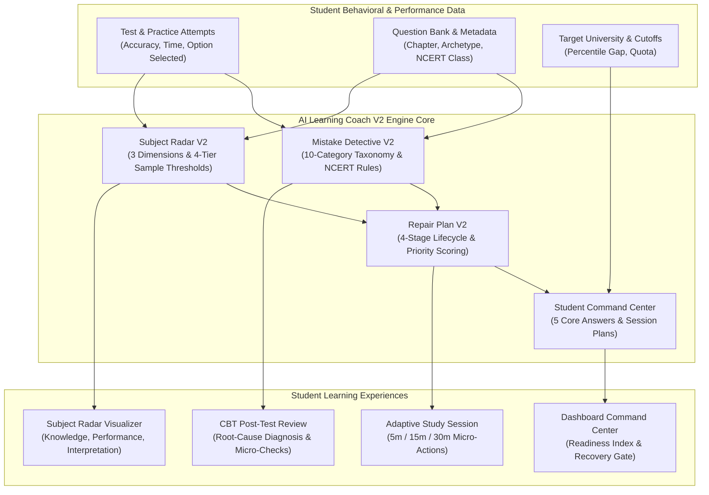

# AI LEARNING COACH V2 ARCHITECTURE — CUET AI-PREP PLATFORM

**System Version**: 2.0.0  
**Architectural Paradigm**: Deterministic Heuristic Analysis, Zero External Inference Cost ($0.00), NCERT-Aligned  
**Status**: Implemented, Verified, and Production-Ready

---

## 1. System Architecture Diagram



---

## 2. Core Pillar 1: Mistake Detective Engine (`lib/mistake-detective.ts`)

The Mistake Detective moves beyond generic "correct/incorrect" feedback by classifying student errors into an authoritative 10-category taxonomy.

### 2.1. The 10-Category Mistake Taxonomy
1. **`CONCEPTUAL_MISUNDERSTANDING`**: Fundamental confusion about physical laws, mathematical theorems, or grammatical rules.
2. **`MISSING_PREREQUISITE`**: Error stemming from lack of foundational knowledge required before tackling the current concept.
3. **`FORMULA_METHOD_ERROR`**: Choosing the wrong formula, sign convention inversion, or flawed step sequence.
4. **`CALCULATION_EXECUTION_ERROR`**: Algebraic slip, decimal error, or arithmetic error while applying the correct concept.
5. **`QUESTION_MISINTERPRETATION`**: Misreading "NOT correct", overlooking unit conversions, or confusing "Assertion" vs "Reason".
6. **`INCORRECT_CONCEPT_APPLICATION`**: Knowing the definition but applying it outside its domain of validity.
7. **`TIME_MANAGEMENT_PACING`**: Error resulting from severe rushing (<15s) or getting bogged down (>150s) leading to panic guessing.
8. **`REPEATED_ERROR_PATTERN`**: Systematic recurrence of the same error archetype across 3+ attempts.
9. **`CARELESS_ERROR`**: Fast selection of a distractor option despite knowing the concept, often on easy questions.
10. **`UNCLASSIFIED_INSUFFICIENT_EVIDENCE`**: Ambiguous attempts with insufficient behavioral telemetry.

### 2.2. Confidence Tiers & Clarification Questions
- **`HIGH`**: Strong signal backed by both time spent, distractor pattern, and question archetype.
- **`MEDIUM`**: Clear behavioral indicator, but partial ambiguity between two categories.
- **`LOW`**: Insufficient data; triggers an interactive single-click student clarification question (e.g. *"Did you get stuck on the algebra or did you forget the formula?"*).

---

## 3. Core Pillar 2: Subject Radar V2 (`lib/subject-radar-v2.ts`)

Subject Radar V2 evaluates mastery across three distinct operational dimensions, calibrated by sample size confidence thresholds.

### 3.1. The 3 Operational Dimensions
1. **Knowledge Mastery**: Factual recall, NCERT definitions, formula recognition, and fundamental theory.
2. **Performance Execution**: Speed, pacing under pressure, calculation accuracy, and resilience against negative marking.
3. **Interpretation & Reasoning**: Ability to decode complex assertions, evaluate statements, interpret graphs, and parse reading passages.

### 3.2. 4-Tier Sample Size Thresholds
To avoid noisy conclusions based on 1 or 2 lucky guesses:
- **`INSUFFICIENT_DATA` (<5 attempts)**: No score displayed; student prompted to complete foundational drills.
- **`PRELIMINARY_SIGNAL` (5–9 attempts)**: Indicative rating with low weighting in global recommendations.
- **`DEVELOPING_EVIDENCE` (10–19 attempts)**: Moderately reliable signal; triggers targeted micro-repairs.
- **`STRONG_EVIDENCE` (>=20 attempts)**: High-confidence rating driving target college readiness projections.

### 3.3. Cross-Chapter Pattern Detection
The Radar automatically identifies cross-cutting deficits, including:
- **Cross-Subject Numerical Calculation Weakness**: Detecting calculation slips across Physics Electrostatics, Chemistry Solutions, and Mathematics.
- **Statement & Assertion Vulnerability**: High error rates on assertion-reasoning items across both Biology and Political Science.
- **Pacing Collapse in Second Half**: Performance degradation occurring in questions 35–50 of full-length mocks.

---

## 4. Core Pillar 3: Repair Plan V2 (`lib/repair-plan-v2.ts`)

A weak area is not just labeled; it is guided through an active recovery lifecycle.

### 4.1. 4-Stage Progressive Lifecycle
```
[ NOT_STARTED ] ──> [ CONCEPT_REVIEWED ] ──> [ DRILL_COMPLETED ] ──> [ RETEST_COMPLETED ] ──> [ RECOVERED ]
```
- **Recovery Gate**: A weak area transitions to `RECOVERED` if and only if the student achieves **>=80% accuracy** on a targeted retest containing at least 5 questions.

### 4.2. Priority Scoring Formula
Weak areas are ranked dynamically:
$$\text{Priority Score} = (\text{Severity Gap} \times 0.4) + (\text{Sample Size Weight} \times 0.3) + (\text{Exam Weight} \times 0.2) + (\text{Recency} \times 0.1)$$
Where:
- $\text{Severity Gap} = 1.0 - \text{Accuracy}$
- $\text{Sample Size Weight} = \min(1.0, \text{Attempts} / 20)$
- $\text{Exam Weight} = \text{Official NTA Chapter Weightage}$
- $\text{Recency} = \text{Exponential decay since last mistake}$

### 4.3. Adaptive Study Session Templates
- **5-Minute Rapid Drill**: 3 high-yield questions addressing the top careless or calculation error.
- **15-Minute Concept Recovery**: 1 concise NCERT rule review + 5 progressive practice questions.
- **30-Minute Mastery Deep Dive**: Comprehensive multi-archetype drill (theory + numerical + assertion) with timed pressure.

---

## 5. Core Pillar 4: Student Command Center (`lib/command-center.ts`)

The Command Center provides instant, clear answers to the five essential student questions:
1. **"What is my current readiness index?"**: Calculated from weighted subject mastery and mock performance.
2. **"What are my top 3 highest-priority weak areas?"**: Extracted using the Priority Scoring algorithm.
3. **"What should I do right now (5m / 15m / 30m)?"**: Deterministic action cards mapped to current available time.
4. **"What recurring mistake pattern is dragging my score down?"**: Most prevalent mistake category across recent attempts.
5. **"Am I ready for my target college/program cutoff?"**: Projected score vs required category cutoff.

---

## 6. Zero Cost & Scalability Invariants

- **External API Inference**: **$0.00**.
- **Third-Party Model Dependencies**: **None**.
- **Latency**: **< 5ms** local compute overhead.
- **Privacy**: Student attempt telemetry never leaves the application boundary.
