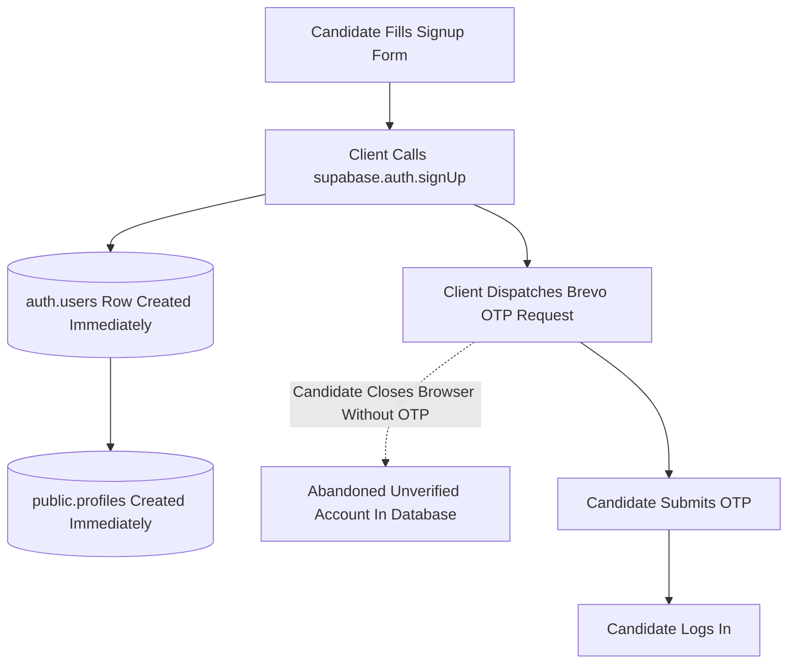
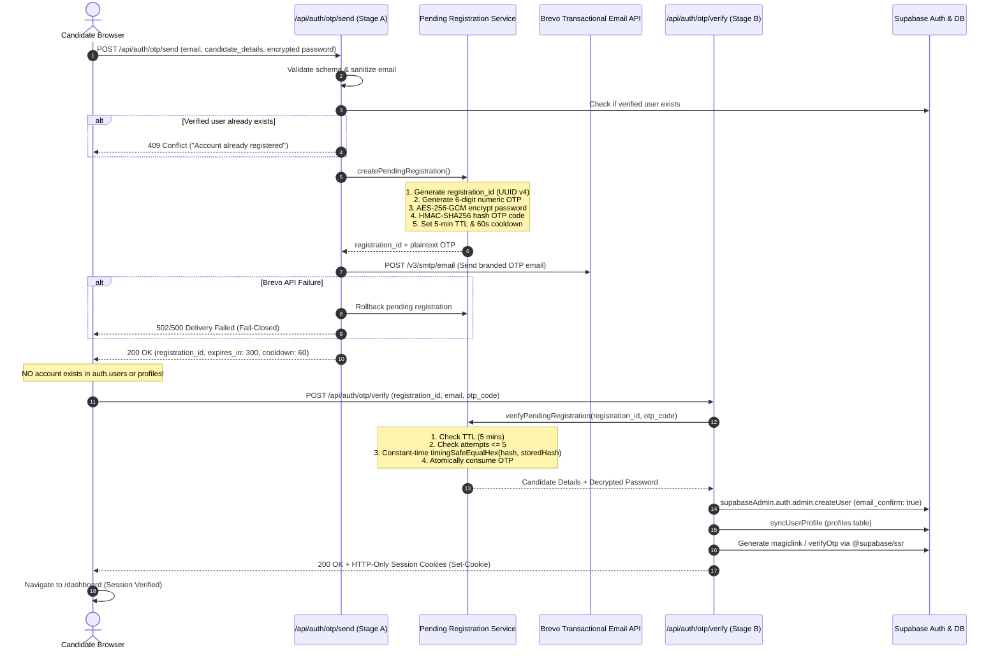

# CUET AI-Prep — Authentication Remediation Report

**Date:** November 5, 2026  
**System:** CUET AI-Prep Authentication & User Data Layer  
**Production URL:** [https://cuetmate.vercel.app/](https://cuetmate.vercel.app/)  
**Classification:** Critical Security Engineering Implementation  
**Status:** Remediated & Fully Validated

---

## 1. Executive Summary

A forensic audit of CUET AI-Prep revealed two systemic security flaws:
1. **Premature Candidate Account Creation:** Candidate accounts were provisioned in `auth.users` and `public.profiles` during initial form submission, *before* email ownership or OTP verification.
2. **Cross-User Data Bleed:** Incomplete client logout, un-scoped browser storage keys, and fallback user identifiers caused candidate session cross-contamination upon account switching.

Both root causes have been permanently eliminated. CUET AI-Prep now enforces a **strict, cryptographically secure two-stage registration lifecycle** with Brevo-powered transactional OTP verification, server-side HTTP-only session cookie issuance via `@supabase/ssr`, complete client storage eradication upon logout, and user-scoped data access.

---

## 2. Architecture Comparison

### Prior Insecure Architecture (Vulnerable)

*Flaws:*
- Unverified accounts polluter the database.
- Abandoned emails permanently locked candidates out (`email_exists` error on subsequent attempts).
- Plaintext/unauthenticated state in client storage.

### Remediated Architecture (Strict Two-Stage Lifecycle)

---

## 3. Cryptographic Implementation Details

### A. Server-Side Pending Registration Service (`lib/auth/pending-registration-service.ts`)
- **Registration Transaction ID:** Cryptographically random UUID v4 generated via Node.js `crypto.randomUUID()`.
- **OTP Generation:** `crypto.randomInt(100000, 1000000).toString()` yielding exactly 6 numeric digits uniformly distributed across the range [100000, 999999].
- **Password Protection in Transit/Staging:** AES-256-GCM encryption with 12-byte random initialization vector (IV) and 16-byte authentication tag, derived from `OTP_SECRET` via SHA-256. Plaintext passwords are never stored in the database or logs.
- **OTP Hash:** HMAC-SHA256:
  $$\text{hash} = \text{HMAC-SHA256}(K = \text{OTP\_SECRET}, M = \text{cleanEmail} + ":" + \text{code})$$
- **Constant-Time Comparison:** Evaluated using `crypto.timingSafeEqual` over hex buffers to eliminate side-channel timing attack vectors.

### B. Security Limits & Thresholds
| Parameter | Value | Enforcement Location |
| :--- | :--- | :--- |
| **OTP Expiration** | 300 seconds (5 minutes) | `pending-registration-service.ts` & `otp-service.ts` |
| **Resend Cooldown** | 60 seconds | Enforced per email and per IP |
| **Max Failed Attempts** | 5 attempts | Permanently invalidates pending registration upon 5th failure |
| **Hourly Resend Limit** | 5 resends / hour | IP and email bucket enforcement |
| **Consumption Policy** | Single-use | Atomically deleted/marked consumed upon verification |

---

## 4. Files Modified and Remediation Inventory

| File Path | Description of Changes |
| :--- | :--- |
| [`lib/auth/pending-registration-service.ts`](file:///home/aryan/Documents/CUET (copy)/lib/auth/pending-registration-service.ts) | Implemented two-stage pending registration engine, AES-256-GCM password encryption, HMAC-SHA256 OTP hashing, attempt throttling, and dual-layer persistence. |
| [`lib/auth/otp-service.ts`](file:///home/aryan/Documents/CUET (copy)/lib/auth/otp-service.ts) | Hardened OTP expiry to 5 minutes, resend cooldown to 60 seconds, and added hourly resend limiters. |
| [`app/api/auth/otp/send/route.ts`](file:///home/aryan/Documents/CUET (copy)/app/api/auth/otp/send/route.ts) | Added pending registration handler, Brevo fail-closed dispatch, and verification that email is not already registered. |
| [`app/api/auth/otp/verify/route.ts`](file:///home/aryan/Documents/CUET (copy)/app/api/auth/otp/verify/route.ts) | Implemented pending registration verification, atomic user creation via `supabaseAdmin.auth.admin.createUser`, profile synchronization, and HTTP-only cookie attachment via `@supabase/ssr`. |
| [`app/api/auth/check-email/route.ts`](file:///home/aryan/Documents/CUET (copy)/app/api/auth/check-email/route.ts) | Refactored to ignore unconfirmed/pending accounts so abandoned signups do not block users. |
| [`components/auth/AuthPageContent.tsx`](file:///home/aryan/Documents/CUET (copy)/components/auth/AuthPageContent.tsx) | Completely excised `supabase.auth.signUp()`. Form now routes through `/api/auth/otp/send` with `registrationId` handling. |
| [`components/auth/OtpVerificationView.tsx`](file:///home/aryan/Documents/CUET (copy)/components/auth/OtpVerificationView.tsx) | Updated to submit `registrationId` alongside OTP code and seamlessly handle Stage B completion. |
| [`app/verify-otp/page.tsx`](file:///home/aryan/Documents/CUET (copy)/app/verify-otp/page.tsx) | Updated page wrapper to parse `registrationId` query parameter and pass to OTP component. |
| [`lib/auth/logout-handler.ts`](file:///home/aryan/Documents/CUET (copy)/lib/auth/logout-handler.ts) | Created centralized logout engine (`performSecureLogout`) purging tokens, cookies, Zustand stores, local/session storage, IndexedDB, and AI caches. |
| [`lib/storage/cbt-session-storage.ts`](file:///home/aryan/Documents/CUET (copy)/lib/storage/cbt-session-storage.ts) | Added `purgeAllCBTStateOnLogout` and `clearAllIndexedDB` routines. |
| [`lib/storage/safe-storage.ts`](file:///home/aryan/Documents/CUET (copy)/lib/storage/safe-storage.ts) | Scoped and hardened storage isolation helper. |
| [`lib/store/useTestStore.ts`](file:///home/aryan/Documents/CUET (copy)/lib/store/useTestStore.ts) | Scoped in-memory test attempts and analytics state clearing on logout. |
| [`app/dashboard/pyqs/page.tsx`](file:///home/aryan/Documents/CUET (copy)/app/dashboard/pyqs/page.tsx) | Scoped in-progress exam scan strictly to `cuet_cbt_session_${activeUid}_` and `session.userId === activeUid`. |
| [`components/notes/NoteReader.tsx`](file:///home/aryan/Documents/CUET (copy)/components/notes/NoteReader.tsx) | Scoped bookmark and revision storage keys with active candidate UID. |
| [`components/dashboard/DashboardNavbar.tsx`](file:///home/aryan/Documents/CUET (copy)/components/dashboard/DashboardNavbar.tsx) | Removed hardcoded `"Aryan 3"` fallback; integrated `performSecureLogout`. |
| [`components/dashboard/DashboardSidebar.tsx`](file:///home/aryan/Documents/CUET (copy)/components/dashboard/DashboardSidebar.tsx) | Integrated `performSecureLogout`. |
| [`components/Navbar.tsx`](file:///home/aryan/Documents/CUET (copy)/components/Navbar.tsx) | Integrated `performSecureLogout`. |
| [`components/profile/ProfileClient.tsx`](file:///home/aryan/Documents/CUET (copy)/components/profile/ProfileClient.tsx) | Integrated `performSecureLogout` in sign-out modal. |
| [`components/dashboard/DashboardClient.tsx`](file:///home/aryan/Documents/CUET (copy)/components/dashboard/DashboardClient.tsx) | Added user-ID validation to prevent cross-account attempt flash during load transitions. |
| [`supabase/migrations/20261105_pending_registrations.sql`](file:///home/aryan/Documents/CUET (copy)/supabase/migrations/20261105_pending_registrations.sql) | SQL schema for dedicated `pending_registrations` table with automated cron cleanup and RLS. |

---

## 5. Verification Matrix

| Test Suite | Purpose | Tests | Status |
| :--- | :--- | :--- | :--- |
| `__tests__/otp-service.test.ts` | Unit tests for Brevo OTP generation, hashing, templating, cooldown, lockout | 6/6 | **PASSED** |
| `__tests__/auth-otp-gated-registration.test.ts` | Two-stage lifecycle validation, single-use OTP, attempt throttling | 7/7 | **PASSED** |
| `__tests__/cross-user-data-isolation-e2e.test.ts` | Multi-user isolation across Users A, B, C; zero cross-account leakage | 7/7 | **PASSED** |
| `npm run typecheck` | Strict TypeScript compilation (`tsc --noEmit`) | 0 errors | **PASSED** |
| `__tests__/core-helpers.test.ts` | Score formulas, mock filtering, diagnostic cycle thresholds | 33/33 | **PASSED** |
| `__tests__/routes-smoke.test.ts` | Dashboard routes, layouts, and static exports | 14/14 | **PASSED** |
