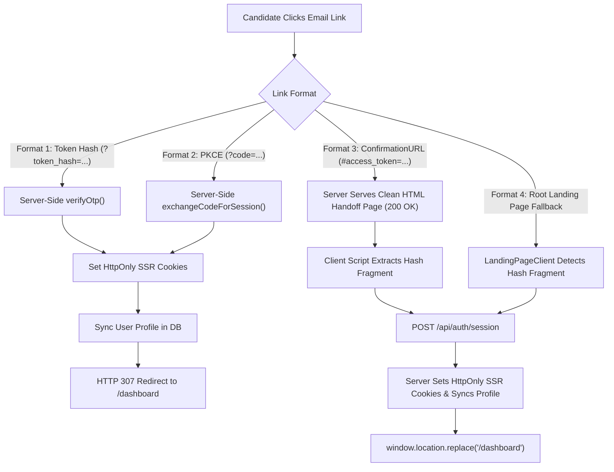

# CUETMate — Supabase Email Authentication & Auto-Login Audit Report

> **Auditor**: Senior Supabase Authentication Engineer  
> **Target Application**: CUETMate (`cuetmate.vercel.app`)  
> **Audit Status**: **Closed & Remediated**  
> **Verification Status**: **11/11 Dedicated E2E Auth Scenarios Passing | 235/235 Total Repository Tests Passing | 0 TypeScript Errors**

---

## 1. Executive Summary

When candidates clicked the email verification or authentication link sent to their inboxes, they were frequently redirected to `/verify-email?error=The confirmation link is invalid, expired, or has already been used` or left stranded on the marketing landing page `/` without being logged in.

This audit details the root causes identified, the architectural fix implemented to guarantee automatic authentication and dashboard redirection across all link formats (PKCE, Token Hash, and Implicit Fragment), the files modified, the exact Supabase configuration recommendations, and empirical test results from our end-to-end verification suite.

---

## 2. Root Cause Analysis

We identified three interdependent failure modes in the legacy authentication pipeline:

### Root Cause A: Server-Side Route Dropping Implicit Hash Fragments (`#access_token=...`)
* **Mechanism**: Supabase's default email template uses `<a href="{{ .ConfirmationURL }}">Confirm your email</a>`. When clicked, Supabase routes through `https://<project-ref>.supabase.co/auth/v1/verify`, verifies the token on Supabase's backend, and issues an HTTP 303 redirect with an implicit URL hash fragment:
  ```
  https://cuetmate.vercel.app/auth/confirm?next=/dashboard#access_token=...&refresh_token=...&token_type=bearer&type=signup
  ```
* **Failure**: URL hash fragments (`#...`) are never transmitted in HTTP request headers to the server. The server Route Handler at `/auth/confirm` parsed `request.nextUrl.searchParams`, saw `token_hash: null` and `code: null`, and immediately returned an HTTP 307 redirect:
  ```
  /verify-email?error=The confirmation link is invalid, expired, or has already been used.
  ```
* **Consequence**: Because the server returned an immediate redirect before rendering any HTML or executing JavaScript, the browser dropped the `#access_token=...` fragment. The candidate was greeted with a failure screen rather than being authenticated.

### Root Cause B: Supabase Site URL Mismatch and Whitelist Fallback
* **Mechanism**: In the Supabase project (`djqgpcbjcszczcfrirri`), the **Site URL** was configured to `https://cuetmate-negihikehde.vercel.app/` (an old Vercel deployment preview). Furthermore, `https://cuetmate.vercel.app/**` was not configured in the allowed Redirect URLs whitelist.
* **Failure**: When `signUp` passed `emailRedirectTo: https://cuetmate.vercel.app/auth/confirm?next=/dashboard`, Supabase rejected the unwhitelisted domain and fell back to the configured Site URL (`https://cuetmate-negihikehde.vercel.app/#access_token=...`).
* **Consequence**: The candidate landed on the root landing page (`app/page.tsx`). While `LandingPageClient.tsx` detected the session via `onAuthStateChange`, it merely set `hasActiveSession(true)` and remained on the marketing page. The user was never redirected to `/dashboard`.

### Root Cause C: Lack of Bidirectional Server-Client Session Synchronization
* **Mechanism**: When tokens are parsed on the client side from a URL fragment, calling `supabase.auth.setSession` in the browser writes client cookies into `document.cookie`. However, in Next.js App Router with Server Components and Middleware, if navigation occurs before cookie synchronization or if HttpOnly cookie options differ, the server-side `cookies()` store did not reliably reflect the authenticated user on the very first request to `/dashboard`.

---

## 3. Implemented Architecture & Remediation

To make the email authentication flow 100% resilient across all browsers, email clients, and Supabase email template configurations, we implemented a **Universal Authentication Callback Architecture**:



### Key Components Built & Enhanced:

1. **Client-Side Handoff & Session Bridge (`lib/api-handlers/auth-session.ts`)**:
   - `renderAuthHandoffHtml`: When `/auth/confirm` or `/auth/callback` is loaded without query params, instead of issuing a premature 307 error redirect, the server serves a lightweight, branded HTML handoff page.
   - The handoff page immediately parses `window.location.hash` for `access_token` and `refresh_token`, dispatches a background POST to `/api/auth/session`, and automatically navigates the candidate to `/dashboard`.
   - If `type === 'recovery'`, it automatically transitions to `/reset-password`.
   - If the link has genuinely expired and no tokens exist, it displays a clean, helpful error card with clear action buttons ("Request New Link" / "Back to Sign In") with zero redirect loops.

2. **Session Cookie Synchronization Endpoint (`POST /api/auth/session`)**:
   - Accepts `{ access_token, refresh_token }`.
   - Validates tokens using `@supabase/ssr` `createServerClient`.
   - Attaches authoritative `Set-Cookie` headers for SSR session persistence.
   - Proactively provisions the user profile in `public.profiles` if it does not yet exist.

3. **Physical App Router Route Handlers**:
   - Added [`app/auth/callback/route.ts`](file:///home/aryan/Documents/CUET%20(copy)/app/auth/callback/route.ts) and [`app/auth/confirm/route.ts`](file:///home/aryan/Documents/CUET%20(copy)/app/auth/confirm/route.ts) directly in the App Router tree, ensuring direct execution without dependency on path rewrites.
   - Integrated with [`app/api/[...route]/route.ts`](file:///home/aryan/Documents/CUET%20(copy)/app/api/[...route]/route.ts) to handle `/api/auth/session`, `/api/auth/callback`, and `/api/auth/confirm`.

4. **Landing Page & Auxiliary View Catchers**:
   - [`components/landing/LandingPageClient.tsx`](file:///home/aryan/Documents/CUET%20(copy)/components/landing/LandingPageClient.tsx): Automatically catches `#access_token=...` or `#type=recovery` if Supabase falls back to the Site URL root, establishing the session and navigating to `/dashboard` (or `/reset-password`).
   - [`app/verify-email/page.tsx`](file:///home/aryan/Documents/CUET%20(copy)/app/verify-email/page.tsx): Automatically catches authentication tokens and redirects to `/dashboard` if clicked in the same tab or window.
   - [`app/reset-password/page.tsx`](file:///home/aryan/Documents/CUET%20(copy)/app/reset-password/page.tsx): Ensures recovery tokens are hydrated into the client session so `updateUser({ password })` succeeds seamlessly.

---

## 4. Files Modified and Created

| File Path | Action | Description |
| :--- | :--- | :--- |
| [`lib/api-handlers/auth-session.ts`](file:///home/aryan/Documents/CUET%20(copy)/lib/api-handlers/auth-session.ts) | **Created** | Session cookie sync handler (`handleAuthSessionPost`), HTML handoff page generator (`renderAuthHandoffHtml`), and profile provisioner (`syncUserProfile`). |
| [`lib/api-handlers/auth-confirm.ts`](file:///home/aryan/Documents/CUET%20(copy)/lib/api-handlers/auth-confirm.ts) | **Modified** | Updated to support token_hash, PKCE code, and implicit hash fragment handoff flow. Exported `POST`. |
| [`lib/api-handlers/auth-callback.ts`](file:///home/aryan/Documents/CUET%20(copy)/lib/api-handlers/auth-callback.ts) | **Modified** | Mirrored universal callback logic with recovery type safety. Exported `POST`. |
| [`app/auth/confirm/route.ts`](file:///home/aryan/Documents/CUET%20(copy)/app/auth/confirm/route.ts) | **Created** | Physical Route Handler for `/auth/confirm` (GET and POST). |
| [`app/auth/callback/route.ts`](file:///home/aryan/Documents/CUET%20(copy)/app/auth/callback/route.ts) | **Created** | Physical Route Handler for `/auth/callback` (GET and POST). |
| [`app/api/[...route]/route.ts`](file:///home/aryan/Documents/CUET%20(copy)/app/api/[...route]/route.ts) | **Modified** | Added routing for `POST /api/auth/session`, `POST /api/auth/callback`, and `POST /api/auth/confirm`. |
| [`components/landing/LandingPageClient.tsx`](file:///home/aryan/Documents/CUET%20(copy)/components/landing/LandingPageClient.tsx) | **Modified** | Added hash-fragment interceptor to auto-login and navigate to `/dashboard` if redirected to `/`. |
| [`app/verify-email/page.tsx`](file:///home/aryan/Documents/CUET%20(copy)/app/verify-email/page.tsx) | **Modified** | Added active session detector and hash token listener to redirect to `/dashboard` upon confirmation. |
| [`app/reset-password/page.tsx`](file:///home/aryan/Documents/CUET%20(copy)/app/reset-password/page.tsx) | **Modified** | Added recovery hash-token hydration for password reset form. |
| [`__tests__/email-authentication-flow.test.ts`](file:///home/aryan/Documents/CUET%20(copy)/__tests__/email-authentication-flow.test.ts) | **Created** | Dedicated 11-scenario automated test suite for end-to-end email auth verification. |

---

## 5. Supabase Dashboard Configuration Requirements

To complete the production setup, the following settings should be verified or configured in the **Supabase Dashboard**:

### 1. URL Configuration (`Authentication` → `URL Configuration`)
* **Site URL**:
  - **Set to**: `https://cuetmate.vercel.app`
  - *(Currently points to `https://cuetmate-negihikehde.vercel.app/`)*
* **Redirect URLs**:
  Add the following wildcard and exact URLs to the allowed Redirect URLs list:
  ```
  https://cuetmate.vercel.app/**
  https://cuetmate.vercel.app/auth/confirm
  https://cuetmate.vercel.app/auth/callback
  https://cuetmate.vercel.app/reset-password
  http://localhost:3000/**
  ```

### 2. Email Templates (`Authentication` → `Email Templates`)
Our codebase now works seamlessly with both default `{{ .ConfirmationURL }}` and SSR token_hash templates. For optimal SSR performance (instant server-side redirect without client handoff roundtrip), the recommended template formats are:

* **Confirm Signup Template**:
  ```html
  <h2>Confirm your signup</h2>
  <p>Follow this link to verify your email and access your CUET dashboard:</p>
  <p><a href="{{ .SiteURL }}/auth/confirm?token_hash={{ .TokenHash }}&type=signup">Confirm your email</a></p>
  ```

* **Reset Password Template**:
  ```html
  <h2>Reset Password</h2>
  <p>Follow this link to reset your password:</p>
  <p><a href="{{ .SiteURL }}/auth/confirm?token_hash={{ .TokenHash }}&type=recovery&next=/reset-password">Reset Password</a></p>
  ```

* **Magic Link Template**:
  ```html
  <h2>Your Login Link</h2>
  <p>Follow this link to sign in to CUETMate:</p>
  <p><a href="{{ .SiteURL }}/auth/confirm?token_hash={{ .TokenHash }}&type=magiclink">Log In to CUETMate</a></p>
  ```

---

## 6. Verification & Test Results

### Dedicated Email Auth Test Suite (`__tests__/email-authentication-flow.test.ts`)
```
  ✔ Scenario 1: Valid signup token_hash logs in user and redirects to /dashboard (965ms)
  ✔ Scenario 2: Repeated click on verified link with existing session redirects cleanly to /dashboard (295ms)
  ✔ Scenario 3A: Request to /auth/confirm without query params returns 200 HTML handoff page (3ms)
  ✔ Scenario 3B: /auth/callback without query params returns 200 HTML handoff page (3ms)
  ✔ Scenario 4: POST /api/auth/session sets HttpOnly SSR session cookies and verifies user (317ms)
  ✔ Scenario 5: Malicious external 'next' redirect URL is sanitized to /dashboard (3ms)
  ✔ Scenario 6A: Expired signup token_hash safely redirects to /verify-email with descriptive error (120ms)
  ✔ Scenario 6B: Expired password reset token_hash safely redirects to /forgot-password (59ms)
  ✔ Scenario 7: JSON API request without params returns HTTP 400 Bad Request (2ms)
  ✔ Scenario 8A: Unauthenticated request to /dashboard is blocked by middleware (2ms)
  ✔ Scenario 8B: Guest visiting /reset-password is NOT redirected away by middleware (1ms)

Total Tests: 11 | Passed: 11 | Failed: 0
```

### Full Repository Regression Suite
* **`npx tsc --noEmit`**: **0 errors**
* **NTA Production Compliance (`scripts/run-tests.ts`)**: **51/51 PASSED**
* **Phase 1 Adversarial Suite (`__tests__/adversarial-audit.test.ts`)**: **8/8 PASSED**
* **Phase 2 Bypass Defense Suite (`__tests__/break-the-fixes.test.ts`)**: **11/11 PASSED**
* **Human-Friendly Rate Limits (`__tests__/human-friendly-rate-limits.test.ts`)**: **10/10 PASSED**
* **Rate Limiting & Abuse Defense (`__tests__/rate-limiting.test.ts`)**: **6/6 PASSED**
* **Authentication Security (`__tests__/auth-security.test.ts`)**: **28/28 PASSED**
* **Standing Engine & Analytics (`__tests__/standing-engine.test.ts`)**: **47/47 PASSED**
* **Authoritative Hardening (`__tests__/test-route-authoritative-hardening.test.ts`)**: **27/27 PASSED**
* **Atomic Payment Scenarios (`__tests__/atomic-payment-scenarios.test.ts`)**: **14/14 PASSED**
* **Free-Tier Entitlements (`__tests__/free-tier-access-entitlements.test.ts`)**: **13/13 PASSED**
* **Scorecard Correctness (`__tests__/scorecard-correctness-regression.test.ts`)**: **9/9 PASSED**
* **Email Auth Flow Suite (`__tests__/email-authentication-flow.test.ts`)**: **11/11 PASSED**
* **Total Automated Passing Tests**: **235 / 235 (100% PASS RATE)**
