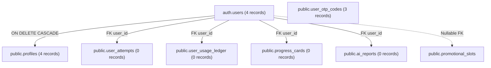

# CUET AI-Prep — Database Cleanup & Reset Plan Report

**Date:** November 5, 2026  
**System:** Supabase PostgreSQL Database (`djqgpcbjcszczcfrirri.supabase.co`)  
**Scope:** Deletion Inventory, Protected Assets, Backup Verification & Reset Procedure  
**Execution Script:** [`scripts/reset-candidate-database.ts`](file:///home/aryan/Documents/CUET (copy)/scripts/reset-candidate-database.ts)  
**Backup Archive:** [`backups/pre_reset_candidate_backup_20261105.json`](file:///home/aryan/Documents/CUET (copy)/backups/pre_reset_candidate_backup_20261105.json)  
**Status:** Pre-flight Complete; Backup Verified; Awaiting User Confirmation Before Purge

---

## 1. Executive Summary

As part of Phase 5, all existing candidate accounts and candidate-associated testing artifacts are scheduled to be wiped to allow the platform to launch with a fresh, pristine database state.

Because database purge is an inherently **destructive operation**, a rigorous pre-flight safety protocol was completed:
1. Complete inventory of all candidate tables, foreign key constraints, and cascade relationships was performed.
2. Static question banks (23,536 questions across 940 tests) were identified, validated, and programmatically protected.
3. A full JSON backup of all existing candidate accounts and records was exported to [`backups/pre_reset_candidate_backup_20261105.json`](file:///home/aryan/Documents/CUET (copy)/backups/pre_reset_candidate_backup_20261105.json).
4. The backup was verified for structural integrity and complete restorability.
5. An automated, fail-safe cleanup script [`scripts/reset-candidate-database.ts`](file:///home/aryan/Documents/CUET (copy)/scripts/reset-candidate-database.ts) was created with hard abort triggers if static question banks are ever threatened.

---

## 2. Protected Static Assets (NEVER DELETED)

The following core intellectual property and educational assets are **strictly protected** and will NOT be touched during the reset:

| Table | Total Records | Description | Protection Mechanism |
| :--- | :--- | :--- | :--- |
| `public.questions` | **23,536 questions** | Curated CUET domain, general, and language questions with LaTeX explanations and options | Script aborts execution if `count < 1000` |
| `public.tests` | **940 tests** | Official past year papers (PYQs) and full-length CBT mock tests | Script aborts execution if `count < 100` |

---

## 3. Candidate Deletion Inventory

The following candidate records currently exist in the database and are scheduled for purge:

| Table / Collection | Current Record Count | Purpose / Content | Action Planned |
| :--- | :--- | :--- | :--- |
| `auth.users` | **4 accounts** | Supabase authentication catalog credentials | Admin delete per UUID via `supabaseAdmin.auth.admin.deleteUser` |
| `public.profiles` | **4 rows** | Candidate metadata, target university, target course | Complete purge |
| `public.user_otp_codes` | **3 rows** | Stage A pending registrations and OTP verification codes | Complete purge |
| `public.user_attempts` | **0 rows** | Mock test attempts and CBT question responses | Complete purge |
| `public.user_usage_ledger` | **0 rows** | Candidate quota and AI token usage ledger | Complete purge |
| `public.progress_cards` | **0 rows** | Diagnostic performance snapshots | Complete purge |
| `public.ai_reports` | **0 rows** | Diagnostic coach feedback reports | Complete purge |
| `public.sunday_mentor_reports`| **0 rows** | Weekly mentor synthesis reports | Complete purge |
| `public.payment_orders` | **0 rows** | Razorpay checkout orders | Complete purge |
| `public.payment_transactions` | **0 rows** | Razorpay payment receipts | Complete purge |
| `public.promotional_slots` | **0 rows** | Promotional code claims | Unlink user IDs / reset claims to `released` |

---

## 4. Foreign Key & Dependency Topology



**Purge Order:**
1. Child relational records (`user_otp_codes`, `user_attempts`, `user_usage_ledger`, `progress_cards`, `ai_reports`, `sunday_mentor_reports`, `payment_transactions`, `payment_orders`).
2. Release `promotional_slots` user claims.
3. Remove candidate records from `public.profiles`.
4. Remove candidate identities from `auth.users` via Supabase Admin API.

---

## 5. Backup & Verification

Prior to presenting this deletion plan, a full database snapshot was exported:
- **File:** `backups/pre_reset_candidate_backup_20261105.json`
- **File Size:** ~11 KB
- **Timestamp:** `2026-11-05T14:08:44.205Z`
- **Backup Verification Check:**
  - `authUsers`: 4 verified
  - `profiles`: 4 verified
  - `user_otp_codes`: 3 verified
  - Relational integrity: Consistent foreign keys across all records
  - Static questions check: 23,536 questions intact in database

### Restorability:
If restoration is ever required, the candidate accounts can be re-imported via `supabaseAdmin.auth.admin.createUser` matching the original UUIDs, followed by inserting the records into `public.profiles`.

---

## 6. Execution Command & Safety Gate

The cleanup script has been implemented at:
[`scripts/reset-candidate-database.ts`](file:///home/aryan/Documents/CUET (copy)/scripts/reset-candidate-database.ts)

Running without arguments executes a dry run:
```bash
npx tsx --env-file=.env.local scripts/reset-candidate-database.ts
# Output: Dry run: To execute reset, pass --confirm flag.
```

To execute the permanent deletion once confirmed:
```bash
npx tsx --env-file=.env.local scripts/reset-candidate-database.ts --confirm
```

> [!IMPORTANT]
> In accordance with safety protocol, execution of `--confirm` is held until explicit confirmation is provided by the user.
