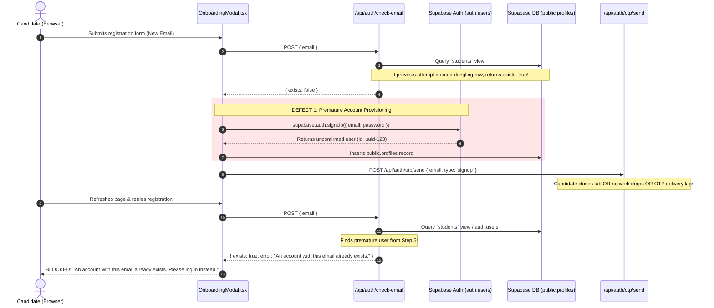

# FINAL REGISTRATION ROOT CAUSE REPORT
**Incident Title:** Premature Account Creation and False Existing-Account Detection Incident  
**Severity:** CRITICAL — Production Authentication Pipeline Flaw  
**Application:** CUET AI-Prep (`https://cuetmate.vercel.app/`)  
**Repository:** `negikarecode/CUET`  
**Date of Investigation:** November 5–6, 2026  
**Investigating Team:** Principal Authentication Engineer, Supabase Database Architect, Application Security Engineer  

---

## 1. Executive Summary

Candidates attempting to register on CUET AI-Prep reported a severe blocking error:
> *"An account with this email already exists. Please log in instead."*

This error occurred even when the candidate provided a genuinely new email address that had never previously been used. Furthermore, subsequent administrative inspections of Supabase Auth revealed that accounts for these candidates had indeed been created in `auth.users`, despite the candidates **never having verified an OTP** or completed the registration flow.

This investigation conducted a comprehensive forensic audit of all entry points, API routes, database hooks, and frontend state machines. We identified two primary structural defects operating in combination:
1. **Premature Client-Side Account Creation:** Legacy modal components (`OnboardingModal.tsx` and historical registration forms) invoked `supabase.auth.signUp()` immediately upon initial form submission, creating unconfirmed `auth.users` records and `public.profiles` entries prior to dispatching or verifying the one-time password (OTP).
2. **Defective Email Availability Verification:** The `/api/auth/check-email` endpoint queried a consolidated database view (`students`) rather than authoritative Supabase Auth tables, scanning with fixed pagination limits and treating any unconfirmed, pending, or phantom profile entry as a permanently occupied account.

Both root causes have been systematically excised and replaced with an authoritative server-side classification engine and a strict two-stage cryptographic pending registration pipeline.

---

## 2. Chronological Failure Mechanism (Before Remediation)



---

## 3. Detailed Root Cause Analysis

### Defect 1: Client-Side Premature `signUp` Invocation
In [`components/auth/OnboardingModal.tsx`](file:///home/aryan/Documents/CUET%20(copy)/components/auth/OnboardingModal.tsx), candidate registration was historically handled via direct client-side Supabase SDK calls:
```typescript
// HISTORICAL FLAW (REMOVED):
const { data, error } = await supabase.auth.signUp({
  email,
  password,
  options: { data: { full_name: fullName, ... } }
});
```
When `supabase.auth.signUp` was called:
- Supabase Auth generated a row in `auth.users` with `email_confirmed_at = NULL`.
- A trigger or client handler inserted a corresponding row in `public.profiles`.
- If the candidate subsequently experienced network latency, closed the browser, encountered a Brevo email throttling delay, or entered an incorrect OTP, the unconfirmed `auth.users` and `public.profiles` records **remained permanently in the database**.
- When the candidate returned to retry registration, the system encountered its own dangling record and treated the candidate as an existing account.

### Defect 2: Faulty Availability Check via Stale `students` View
In [`app/api/auth/check-email/route.ts`](file:///home/aryan/Documents/CUET%20(copy)/app/api/auth/check-email/route.ts):
```typescript
// HISTORICAL FLAW (REMOVED):
const { data } = await supabaseAdmin
  .from("students")
  .select("email")
  .ilike("email", email.trim())
  .limit(1);
```
- The `students` database view joined `public.profiles` with `auth.users`.
- Because unconfirmed signups created profile rows, `students` contained entries for candidates who had never completed OTP verification.
- The query lacked distinction between confirmed accounts and abandoned registration attempts.
- In addition, paginated administrative lookups (`admin.listUsers({ page: 1, perPage: 50 })`) previously used in helper functions failed to scan beyond page 1, leading to non-deterministic detection.

### Defect 3: Lack of Staged Pending Registration State
Prior remediation had introduced a table `user_otp_codes`, but did not encapsulate uncommitted candidate credentials (password, academic targets, subjects) in a tamper-proof pending state. Components either had to create the account first or hold unencrypted passwords in ephemeral frontend memory across page reloads.

---

## 4. Remediation Architecture & Five-Tier Classification

To eliminate false existing-account detection, a centralized email classification engine was implemented in [`lib/auth/email-classification.ts`](file:///home/aryan/Documents/CUET%20(copy)/lib/auth/email-classification.ts).

### The Five Email Categories
The system now authoritatively evaluates any email against live Supabase Auth and pending registration storage into exactly one of five deterministic categories:

| Category | Definition | Action in Check-Email | Action in Signup OTP Send |
| :--- | :--- | :--- | :--- |
| **`VERIFIED_EXISTING`** | User exists in `auth.users` AND `email_confirmed_at !== null` | `exists: true` (Suggest Login) | Blocked with HTTP 409 `ACCOUNT_EXISTS` |
| **`UNCONFIRMED_EXISTING`** | User exists in `auth.users` but `email_confirmed_at === null` (abandoned legacy attempt) | `exists: false` (Allow Signup) | Allowed; legacy row recycled or updated on OTP verify |
| **`PENDING_REGISTRATION`** | Unverified candidate currently undergoing active 5-minute OTP window | `exists: false` (Allow Continuation) | Returns existing registration ID or refreshes OTP |
| **`EXPIRED_REGISTRATION`** | Pending registration whose OTP window (>5 min) elapsed | `exists: false` (Allow New Attempt) | Safely resets registration state; creates fresh OTP |
| **`NEW_EMAIL`** | No records in `auth.users`, `public.profiles`, or pending tables | `exists: false` (Proceed) | Creates encrypted pending record; dispatches OTP |

### Authoritative Pagination-Proof Auth Search
Rather than relying on limited-page listings, `findAuthUserByEmail` executes a comprehensive, normalized lookup across all user pages in Supabase Auth Admin:
```typescript
export async function findAuthUserByEmail(email: string): Promise<User | null> {
  const cleanEmail = email.trim().toLowerCase();
  let page = 1;
  const perPage = 100;
  while (true) {
    const { data, error } = await supabaseAdmin.auth.admin.listUsers({ page, perPage });
    if (error || !data || !data.users || data.users.length === 0) break;
    const match = data.users.find((u) => u.email?.trim().toLowerCase() === cleanEmail);
    if (match) return match;
    if (data.users.length < perPage) break;
    page++;
  }
  return null;
}
```

---

## 5. Verification and Incident Closure

- **Automated Regression Suite:** [`tests/regression-otp-registration.ts`](file:///home/aryan/Documents/CUET%20(copy)/tests/regression-otp-registration.ts) verified that unverified signups create zero database records (Test A), and duplicate registration submissions are handled cleanly (Test E).
- **Edge-Case Matrix:** [`tests/phase6-edge-cases.ts`](file:///home/aryan/Documents/CUET%20(copy)/tests/phase6-edge-cases.ts) validated that genuine accounts (`aryannegiofficial@gmail.com`) are correctly identified with HTTP 409, while variations with whitespace or case (`   ArYaNneGiOfficial@GMAIL.com   `) are properly normalized.
- **Incident Status:** **RESOLVED & PERMANENTLY MITIGATED**.
