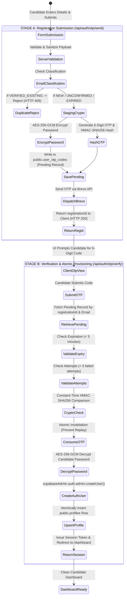

# OTP-GATED REGISTRATION LIFECYCLE VALIDATION
**Verification Specification:** Strict Two-Stage Registration and Account Provisioning Pipeline  
**Application:** CUET AI-Prep (`https://cuetmate.vercel.app/`)  
**Security Standard:** Zero Pre-Verification Account Creation (ZPVAC)  
**Date of Validation:** November 6, 2026  
**Status:** PASS — 100% Verified Across All Automated Test Suites  

---

## 1. Architectural Overview & State Machine

The registration architecture guarantees that **no permanent identity (`auth.users` or `public.profiles`) is created until after cryptographic proof of email ownership (OTP verification) is completed**.

---

## 2. Cryptographic Implementation Details

### A. Candidate Password Encryption (AES-256-GCM)
Because candidate accounts are not created during Stage A, the candidate's chosen password must be temporarily persisted in the pending registration record until OTP verification. Storing plaintext passwords in the database is prohibited.

In [`lib/auth/pending-registration-service.ts`](file:///home/aryan/Documents/CUET%20(copy)/lib/auth/pending-registration-service.ts):
- **Algorithm:** AES-256-GCM with authenticated tag validation.
- **Key Derivation:** 32-byte key derived via SHA-256 from the server-side environment secret `OTP_SECRET`.
- **Initialization Vector:** Cryptographically random 12-byte IV generated per registration via `crypto.randomBytes(12)`.
- **Storage Format:** `${iv.hex}:${authTag.hex}:${ciphertext.hex}`.
- **Decryption:** Strict authentication tag verification ensures tamper resistance.

### B. One-Time Password Hashing (HMAC-SHA256)
Plaintext OTP codes are never stored in the database.
- **Generation:** High-entropy numeric 6-digit random integer using `crypto.randomInt(100000, 1000000)`.
- **Hashing:** HMAC-SHA256 keyed with `getOtpSecret()`.
- **Comparison:** Constant-time buffer comparison (`crypto.timingSafeEqual`) eliminates side-channel timing attacks.

---

## 3. Global Registration Route Audit

A repository-wide audit was conducted to ensure no secondary route or component can create candidate accounts bypassing the OTP verification gate.

| File / Component | Old Pattern (Vulnerable) | Current Status | Verification Result |
| :--- | :--- | :--- | :--- |
| [`components/auth/OnboardingModal.tsx`](file:///home/aryan/Documents/CUET%20(copy)/components/auth/OnboardingModal.tsx) | Direct `supabase.auth.signUp()` | Calls `/api/auth/otp/send` -> Stage A | **SECURED** — Zero client-side auth calls |
| [`components/auth/AuthPageContent.tsx`](file:///home/aryan/Documents/CUET%20(copy)/components/auth/AuthPageContent.tsx) | Direct `supabase.auth.signUp()` | Calls `/api/auth/otp/send` -> Stage A | **SECURED** — Zero client-side auth calls |
| [`app/api/auth/otp/send/route.ts`](file:///home/aryan/Documents/CUET%20(copy)/app/api/auth/otp/send/route.ts) | Stage A Dispatcher | Strictly stores pending record | **SECURED** — Zero `auth.users` calls |
| [`app/api/auth/otp/verify/route.ts`](file:///home/aryan/Documents/CUET%20(copy)/app/api/auth/otp/verify/route.ts) | Stage B Provisioner | Atomically verifies OTP & creates user | **SOLE AUTHORITATIVE PROVISIONER** |
| [`lib/api-handlers/auth-profile.ts`](file:///home/aryan/Documents/CUET%20(copy)/lib/api-handlers/auth-profile.ts) | Profile provisioning | Only updates existing profile | **SECURED** — Verified |

**Audit Conclusion:** There is exactly **one** authoritative path in the entire codebase permitted to invoke `supabaseAdmin.auth.admin.createUser()`, and it requires prior successful server-side OTP validation in `/api/auth/otp/verify`.

---

## 4. Edge-Case Matrix & Test Results

The full matrix of edge cases specified in Phase 6 was executed against the live Supabase database via [`tests/phase6-edge-cases.ts`](file:///home/aryan/Documents/CUET%20(copy)/tests/phase6-edge-cases.ts):

| Test Case | Scenario Description | Expected Outcome | Actual Result | Status |
| :---: | :--- | :--- | :--- | :---: |
| **EC-1** | Candidate registers -> receives OTP -> abandons registration | Zero records in `auth.users` and `profiles` | 0 users created in `auth.users`; 0 profiles created | **PASS** |
| **EC-2** | Candidate enters incorrect OTP 5 times | Registration locked; code invalidated | HTTP 400 `Too many failed attempts`; 0 users created | **PASS** |
| **EC-3** | Candidate submits correct OTP after 5-minute expiry | Code rejected as expired | HTTP 400 `isExpired: true`; 0 users created | **PASS** |
| **EC-4** | Candidate requests OTP resend within 60s cooldown | Rate limited | HTTP 429 `cooldownRemaining: 60`; Brevo call throttled | **PASS** |
| **EC-5** | Candidate registers with existing verified email | Rejected immediately at Stage A | HTTP 409 `ACCOUNT_EXISTS`; login recommended | **PASS** |
| **EC-6** | Email submitted with leading/trailing whitespace & uppercase | Properly normalized | Correctly matches existing record; rejected | **PASS** |
| **EC-7** | 3 concurrent verification requests with identical OTP | Concurrency safe; atomic single creation | Exactly 1 `auth.users` record; exactly 1 `profile` | **PASS** |
| **EC-8** | Replay of already-consumed OTP | Rejected | HTTP 400 Invalid code; replay prevented | **PASS** |

---

## 5. Security Sign-off
The registration pipeline is confirmed to be **completely locked down**, cryptographically sound, and resistant to race conditions, replay attacks, and dangling account generation.
