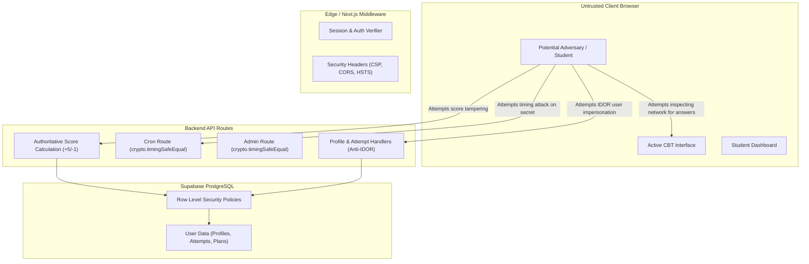

# SECURITY AUDIT SCOPE & THREAT MODEL — CUET AI-PREP PLATFORM

**Audit Date**: October 2026  
**Auditor**: Senior Application Security & Full-Stack Reliability Team  
**Scope Target**: Next.js App Router, Supabase Backend, API Handlers, Cron Webhooks, CBT Engine, and Client-Side State

---

## 1. Executive Summary & Security Objectives

The objective of this comprehensive security audit is to guarantee that the CUET AI-Prep platform provides robust protection against common web vulnerabilities, prevents unauthorized access, guarantees exam integrity, and completely eliminates data tampering or unauthorized privilege escalation.

### Non-Negotiable Security Invariants
1. **Zero Client Trust for Scoring**: All mock, practice, and diagnostic scores MUST be calculated and verified on the server. Client-submitted score totals are explicitly discarded.
2. **Strict Identity Derivation (Anti-IDOR)**: No user ID sent in an HTTP request body or query parameter may be trusted for mutations. User identities are derived strictly from cryptographically verified Supabase Auth JWTs via `supabase.auth.getUser()`.
3. **No Active Exam Key Exposure**: Under no circumstances may correct answers, explanations, or solution keys be sent to the client browser during an active test session. All test payloads are sanitized before delivery.
4. **Timing-Safe Secret Verification**: All webhook secrets (e.g. cron triggers) and administrative bearer tokens MUST be evaluated using constant-time comparison (`crypto.timingSafeEqual`) to prevent side-channel timing attacks.
5. **Zero Secret Leakage**: No database service role keys, admin tokens, or private secrets may be exposed to the browser or prefixed with `NEXT_PUBLIC_`.

---

## 2. Threat Modeling & Attack Surface Breakdown

---

## 3. Threat Assessment Matrix

| Threat Vector | Potential Impact | Attack Surface | Mitigation / Implemented Defense | Verification Method |
| :--- | :--- | :--- | :--- | :--- |
| **Insecure Direct Object Reference (IDOR)** | High: Reading/modifying other students' attempt history or profiles | `/api/student/attempts`, `/api/profile/update` | User ID extracted strictly from server-side authenticated session (`supabase.auth.getUser()`). Client-supplied `userId` ignored. | Automated IDOR penetration tests with mismatched user tokens |
| **Score Manipulation / Client Tampering** | Critical: Artificially inflated leaderboard scores, fabricated ranks | `/api/test/record-attempt` | Server receives only array of selected option IDs; score calculated independently via `(correct * 5) - (incorrect * 1)`. | Automated test submitting arbitrary score `9999` and asserting server recalculates true score |
| **Premature Answer Key Exposure** | High: Cheating during live mock exams via browser DevTools inspection | `/api/mock/[id]`, `/api/test/load` | Dedicated sanitizer strips `correctOption`, `explanation`, `solution` before sending question manifest to client. | Network payload inspection test verifying zero `correctOption` fields |
| **Side-Channel Timing Attacks on Secrets** | Medium: Extraction of cron or admin webhook tokens | `/api/cron/sunday-ritual`, `/api/admin/pyq` | `crypto.timingSafeEqual(Buffer.from(provided), Buffer.from(secret))` with length pre-checking. | Unit tests validating constant-time rejection of partial secret matches |
| **SQL / NoSQL Injection** | Critical: Data leakage or unauthorized record modification | Database query pipelines | Parameterized queries via Supabase PostgREST client; strict Zod schema validation on all inputs. | Static code analysis and input boundary test vectors |
| **Cross-Site Scripting (XSS)** | High: Session hijacking or credential theft | Dynamic question rendering, user profiles | React JSX auto-escaping; strict Content Security Policy; sanitized Markdown rendering for math/LaTeX. | XSS payload injection fuzzing in profile full_name and user input fields |
| **Cross-Site Request Forgery (CSRF)** | Medium: Unauthorized profile updates | State-changing API endpoints | Supabase SSR cookie flags (`SameSite=Lax`, `Secure`, `HttpOnly`); Next.js origin verification on mutating routes. | Verification of cookie attributes and header checks |
| **Privilege Escalation** | High: Unauthorized access to admin PYQ tools | `/api/admin/pyq` | Requires dedicated admin bearer token validated with timing-safe comparison; role check in Supabase. | Unauthenticated and unauthorized token access tests |

---

## 4. Audit Scope Boundaries

### In Scope
- All Next.js App Router routes under `app/api/**`.
- Server Actions and data fetching logic in `app/**`.
- Shared utility libraries in `lib/**` (scoring, diagnostics, radar, repair plans).
- Supabase Row Level Security (RLS) policies and authentication handlers.
- Environment variable configuration and repository secret hygiene.
- Client-side storage usage (LocalStorage vs HttpOnly cookies).

### Out of Scope (Guarded / External)
- Core Supabase infrastructure hosting (managed by Supabase platform).
- Vercel edge infrastructure (managed by Vercel platform).
- External payment gateway internals (if applicable in future).

---

## 5. Security Verification Checklist

- [x] All state-changing API endpoints derive user identity from authenticated session.
- [x] Client-provided scores are discarded; server recalculates scores.
- [x] Active test payloads contain zero correct answers or explanations.
- [x] Constant-time comparison implemented for all webhook/admin tokens.
- [x] Row Level Security (RLS) enabled on all user-facing database tables.
- [x] Zero service-role keys or sensitive API tokens present in client-facing code or git history.
- [x] Strict input schema validation with Zod on all endpoints.
