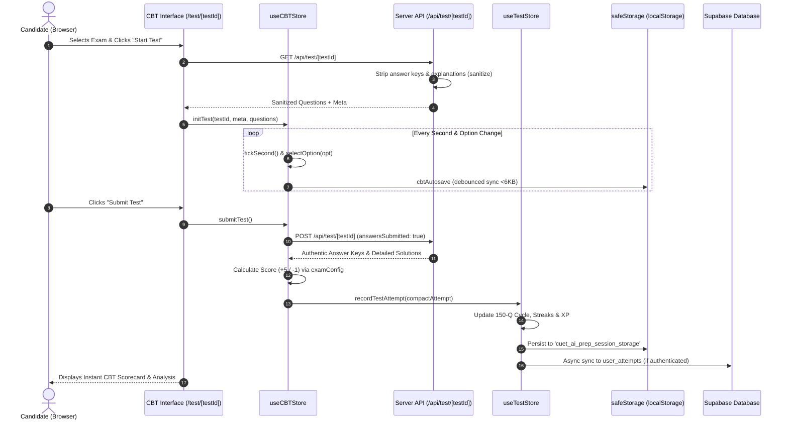

# 01 — PROJECT ARCHITECTURE & TECHNOLOGY BLUEPRINT
## CUET AI-Prep Technical Architecture Reference

**Documentation Scope:** Comprehensive inventory of the technology stack, physical directory structure, runtime boundaries, and inter-module dependencies.

---

### A. Technology Stack Inventory

| Category | Technology | Actual Version | Evidence Location | Description & Responsibility |
|---|---|---|---|---|
| **Frontend Framework** | Next.js (App Router) | `14.2.25` | `package.json:34` | Full-stack React framework with SSR, SSG, API route handlers, and server actions. |
| **Language & Typing** | TypeScript | `5.7.3` | `package.json:60` | Strict static typing across all domain engines, schemas, and client stores. |
| **Styling & CSS** | Tailwind CSS | `3.4.17` | `package.json:58` | Utility-first CSS with custom academic SaaS palette (`tailwind.config.ts`). |
| **CSS Utilities** | clsx & tailwind-merge | `2.1.1` / `2.6.0` | `package.json:29,43` | Dynamic conditional class merging without specificity collisions. |
| **UI Icons** | Lucide React | `0.475.0` | `package.json:33` | Scalable SVG icon set for navigation, status badges, and academic tools. |
| **Math & LaTeX** | KaTeX + Rehype/Remark | `0.18.5` | `package.json:32,40-42` | Fast mathematical typesetting for Physics, Chemistry, and Maths equations. |
| **Charts & Visuals** | Recharts & SVG | `2.15.4` | `package.json:39` | Score trajectories, accuracy benchmarks, and subject radar visualizations. |
| **Animation UI** | Framer Motion | `11.18.2` | `package.json:30` | Fluid page transitions, modal overlays, and collapsible panels. |
| **State Management** | Zustand | `5.0.3` | `package.json:44` | Lightweight state management with custom storage engines and action selectors. |
| **Database & Auth** | Supabase (PostgreSQL) | `2.48.1` / `0.5.2` | `package.json:26-27` | Auth session tracking, user profile persistence, and attempt records. |
| **Embedded DB** | better-sqlite3 | `13.0.3` | `package.json:28` | Local SQLite database utilities for question indexing and ingestion tools. |
| **Payments Gateway** | Razorpay SDK | `2.9.8` | `package.json:35` | UPI, card, and net banking checkout orders with HMAC-SHA256 verification. |
| **AI Inference 1** | Google GenAI SDK | `2.24.0` | `package.json:25` | Multimodal / Flash inference (`gemini-2.0-flash`, `gemini-2.5-flash`). |
| **AI Inference 2** | Groq SDK | `1.6.0` | `package.json:31` | Ultra-low latency LPU inference (`llama-3.1-8b-instant`, `compound-mini`). |
| **Testing Runtime** | tsx & Node test runner | `4.23.13` | `package.json:59` | Native TypeScript test execution without compilation overhead. |

---

### B. Architecture Diagram

```mermaid
flowchart TD
    subgraph Client ["Client Layer (Browser Runtime)"]
        UI["React 18 / Next.js Components<br/>(Dashboard, CBT, Standing, Radar, Profile)"]
        
        subgraph ZustandStores ["Client State Management (Zustand 5.0)"]
            CBTStore["useCBTStore<br/>(Active Test Session, Timer, Question Palette)"]
            TestStore["useTestStore<br/>(Attempts History, 150-Q Cycles, Streak, XP)"]
        end
        
        subgraph ClientStorage ["Browser Storage Engine"]
            SafeStorage["safeStorage Utility<br/>(Quota-Bounded, Auto-Pruning, Memory Fallback)"]
            LocalStorage["localStorage<br/>('cuet_ai_prep_session_storage', 'cbt_active_...')"]
        end
    end

    subgraph Server ["Next.js 14 App Router Server"]
        Middleware["Next.js Middleware<br/>(Supabase Session Update, Route Guarding)"]
        
        subgraph ServerRoutes ["Server Route Handlers (/app/api)"]
            AuthRoutes["/api/auth/* & /api/profile/*"]
            TestRoutes["/api/test/[testId]<br/>(Sanitizes Qs during active test)"]
            AttemptRoutes["/api/test/record-attempt"]
            AIRoutes["/api/ai/*<br/>(diagnose, why-wrong, doubt-solver, radar)"]
            PaymentRoutes["/api/payments/*<br/>(create-order, verify, webhook)"]
            StandingRoutes["/api/standing/*"]
        end
        
        subgraph DomainEngines ["Authoritative Domain & Business Logic (/lib)"]
            ExamConfig["examConfig.ts (+5/-1 Scoring Formula)"]
            StandingEngine["standing-engine.ts (14.6MB Cutoffs, Course Rules)"]
            DiagnosticStatus["diagnostic-status.ts (150-Q Authoritative Progress)"]
            CycleEngine["cycle-engine.ts (Window Slicing & Overlap Prevention)"]
            FallbackEngine["diagnostic-engine.ts & mistake-diagnostic.ts"]
        end
    end

    subgraph DataBanks ["Question Banks & Manifests (File System)"]
        PYQBank["/pyq (251 papers, 12,550 Qs)"]
        MockBank["/mock (514 files, 28,100 Qs)"]
        PracticeBank["/practice (3,100 files, 62,000 Qs)"]
        CutoffData["/lib/data/standing (normalized_cutoffs.json 14.6MB)"]
    end

    subgraph ExternalServices ["External Cloud Services"]
        SupabaseDB[("Supabase PostgreSQL<br/>(profiles, user_attempts, RLS)")]
        GroqAPI["Groq LPU API<br/>(Llama 3.1 8B Instant)"]
        GeminiAPI["Google Gemini API<br/>(Gemini 2.0 Flash)"]
        RazorpayAPI["Razorpay Payment Gateway<br/>(Orders, Checkout, Webhooks)"]
    end

    %% Interactions
    UI --> CBTStore
    UI --> TestStore
    CBTStore <--> SafeStorage
    TestStore <--> SafeStorage
    SafeStorage <--> LocalStorage
    
    UI --> Middleware
    Middleware --> ServerRoutes
    
    TestRoutes --> ExamConfig
    TestRoutes --> MockBank
    TestRoutes --> PYQBank
    TestRoutes --> PracticeBank
    
    AttemptRoutes --> SupabaseDB
    StandingRoutes --> StandingEngine
    StandingEngine --> CutoffData
    
    AIRoutes --> FallbackEngine
    AIRoutes -.->|Optional Live Key| GroqAPI
    AIRoutes -.->|Optional Live Key| GeminiAPI
    
    PaymentRoutes --> RazorpayAPI
    PaymentRoutes --> SupabaseDB
```



---

### C. Directory Map

```
/
├── app/                              # Next.js App Router (Pages, Layouts, API Route Handlers)
│   ├── api/                          # Server REST endpoints
│   │   ├── admin/                    # Admin management & PYQ ingestion exports
│   │   ├── ai/                       # Diagnostic AI endpoints with deterministic fallbacks
│   │   ├── auth/ & profile/          # User authentication and profile sync
│   │   ├── payments/                 # Razorpay order creation, verification, and webhook
│   │   ├── standing/                 # Where Do I Stand explainer API
│   │   ├── student/                  # Attempts history and diagnostic cycle telemetry
│   │   └── test/                     # Active test loading & verified score submission
│   ├── dashboard/                    # Student Portal (Dashboard, Mocks, Practice, PYQs, Standing, Profile)
│   ├── login/ & signup/              # Supabase authentication landing pages
│   ├── test/[testId]/                # Fullscreen CBT examination interface
│   ├── layout.tsx & globals.css      # Root HTML shell and base Tailwind CSS imports
│   └── page.tsx                      # Public landing page
├── components/                       # Reusable React components
│   ├── cbt/                          # CBT Exam UI (Palette, Question Card, Timer, Submit Modal)
│   ├── dashboard/                    # Student Hub widgets, Prep Pulse, Session History, Radar
│   ├── payments/                     # UpgradeButton and payment checkout modal
│   ├── profile/                      # ProfileClient, EditGoalsModal, InvalidTargetBanner
│   └── ui/                           # Primitives (SearchableSelect, Modals, Buttons)
├── lib/                              # Core domain logic, engines, and utilities
│   ├── ai/                           # Gemini SDK client, Groq client, and token logger
│   ├── config/                       # Central examConfig, dashboardConfig, standingConfig
│   ├── constants/                    # CUET subjects, DU colleges, DU courses definitions
│   ├── data/                         # Syllabus schemas, practice manifests, and standing datasets
│   │   └── standing/                 # 14.6 MB canonical courses and normalized cutoffs
│   ├── storage/                      # SafeStorage wrapper and CBT session autosave engine
│   ├── store/                        # Zustand stores (useCBTStore, useTestStore)
│   ├── supabase/                     # Supabase client, server, admin, and middleware
│   ├── analytics.ts                  # Analytics derivation and attempt deduplication
│   ├── cycle-engine.ts               # 150-question window slicing logic
│   ├── diagnostic-status.ts          # Single source of truth diagnostic status
│   └── standing-engine.ts            # Admission eligibility, combination resolution, cutoff comparisons
├── mock/                             # 514 Full-length 50-Q mock papers across 28 subjects (28,100 Qs)
├── practice/                         # 3,100 Unit-level 20-Q practice tests across 14 subjects (62,000 Qs)
├── pyq/                              # 251 Official NTA past year papers (12,550 Qs)
├── supabase/                         # Database migrations and production schema.sql
├── __tests__/                        # Automated test suites (Jest/Node native runner via tsx)
├── scripts/                          # Ingestion, validation, repair, and audit automation scripts
└── package.json                      # Dependencies and npm script definitions
```

---

### D. System Boundaries

#### 1. Browser-Only Functionality
- **CBT Active State**: `useCBTStore` maintains active seconds ticking, current question index, and unsaved option selections purely in browser memory.
- **Auto-Save Throttling**: `cbtAutosave` flushes to `localStorage` every second with debounced write operations.
- **Visual Analytics**: Interactive line charts, SVG radars, and collapsible table-to-card mobile transforms execute entirely client-side.

#### 2. Server-Only Functionality
- **Answer-Key Stripping**: Active tests loaded via `/api/test/[testId]` have all answer keys stripped server-side before response transmission.
- **Cryptographic Verification**: Razorpay HMAC-SHA256 signature calculation occurs strictly on the server using `crypto.timingSafeEqual`.
- **Database Service Role Actions**: Supabase Admin client operates with service-role permissions only within server route handlers.

#### 3. Shared Modules (`/lib`)
- Types in `/types` are shared across frontend UI and backend API routes.
- Scoring formula (`calculateExamScore` in `lib/config/examConfig.ts`) is used both in CBT store for instant scoring and on the server for verification.

#### 4. Persistence Separation
- **Local Persistence**: `safeStorage` manages `localStorage` with safety caps (<6KB per session) to prevent `QuotaExceededError`.
- **Remote Persistence**: Supabase PostgreSQL (`public.profiles`, `public.user_attempts`) acts as the authoritative cloud backup.

---

### E. Critical Flow Dependency Map


