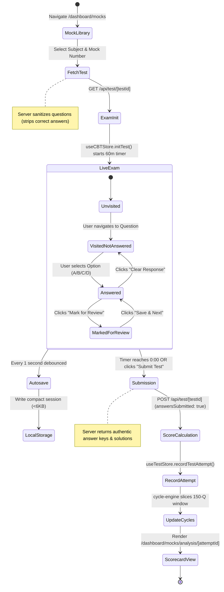
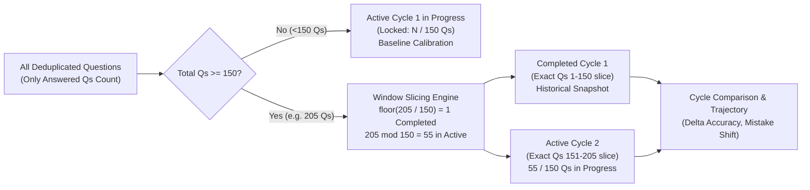

# 03 — USER FLOWS AND BUSINESS RULES
## End-to-End User Journeys, Scoring Logic & Admission Rules

---

### 1. Authoritative Exam Scoring System

All examination scoring across mocks, PYQs, and practice tests is centralized in `lib/config/examConfig.ts` and `lib/store/useCBTStore.ts`.

#### The Authoritative CUET UG Scoring Formula

$$\text{Total Marks} = (N_{\text{correct}} \times 5) + (N_{\text{incorrect}} \times -1) + (N_{\text{unanswered}} \times 0)$$

$$\text{Max Marks} = N_{\text{total questions}} \times 5$$

$$\text{Score Percentage} = \max\left(0, \text{round}\left(\frac{\text{Total Marks}}{\text{Max Marks}} \times 100\right)\right)$$

$$\text{Accuracy Percentage} = \begin{cases} 0 & \text{if } N_{\text{attempted}} = 0 \\ \text{round}\left(\frac{N_{\text{correct}}}{N_{\text{attempted}}} \times 100\right) & \text{if } N_{\text{attempted}} > 0 \end{cases}$$

> [!IMPORTANT]
> **Negative Marking Integrity**:
> 1. Unanswered questions incur strictly **0 penalty** (do not subtract marks).
> 2. Questions marked for review **WITHOUT** an answer incur **0 penalty** and are counted as unattempted.
> 3. Questions answered and marked for review **ARE EVALUATED** according to NTA regulations (+5 if correct, -1 if incorrect).
> 4. Total marks can legally be negative if incorrect answers exceed correct ones (e.g., 2 correct [+10] and 15 incorrect [-15] = -5 marks).

---

### 2. Main User Journeys & State Machines

#### Journey A: Taking a Full-Length CBT Mock Test

#### Failure Recovery during CBT Exam
- **Browser Refresh / Tab Closure**: On page reload at `/test/[testId]`, `useCBTStore` invokes `loadCBTSessionSync(testId)`. The exact elapsed seconds (calculated from `expiresAt - Date.now()`), visited states, option selections, and review flags are restored seamlessly within <10ms.
- **Timer Expiration**: When `remainingSeconds <= 0`, `tickSecond()` automatically triggers `submitTest()` without requiring student confirmation, locking further option selection.
- **Duplicate Submissions**: `isSubmitting` lock flag and session submission checking (`cbtAutosave.isSubmitted(testId)`) prevent race conditions or duplicate record generation.

---

### 3. The 150-Question Diagnostic Cycle System

The diagnostic intelligence system (`lib/cycle-engine.ts`, `lib/diagnostic-status.ts`) operates on strict 150-question non-overlapping windows.

#### Diagnostic Cycle Invariants
1. **Qualifying Criterion**: A question attempt qualifies **if and only if** `selectedOption` is not null or undefined (skipped questions do not count towards the 150-question calibration gate).
2. **Boundary Splitting**: If Test 4 brings the student from 140 to 160 questions, questions 1-10 of Test 4 are allocated to Cycle 1, and questions 11-20 are allocated to Cycle 2.
3. **Zero Cross-Cycle Overlap**: No question attempt is ever evaluated in more than one cycle.

---

### 4. Admission Engine & DU College Matcher Rules

Calculations in `lib/standing-engine.ts` match student domain averages against Delhi University course requirements.

#### Course Subject Resolution Modes
- **`required`**: Subject is mandatory (e.g., Mathematics for B.Sc. Mathematics).
- **`one_of`**: Student must take one subject from a group (e.g., Accountancy OR Mathematics for B.Com Hons). The engine automatically selects the path where the student has higher marks.
- **`best_of`**: Selects the highest scoring domain subjects to fill the remaining degree criteria (e.g., best 2 domain subjects from B1/B2 list).

#### Composite Cutoff & Target Calculation
- **Equal-Share Target**:
  $$\text{Per-Subject Target} = \frac{\text{Projected Total Cutoff}}{\text{Number of Required Subjects}}$$
- **Marks Gap**:
  $$\text{Marks Gap} = \text{Per-Subject Target} - \text{Student Mock Average in Subject}$$
- **Admission Chance Bands**:
  - `High Chance (Dream/Target)`: Student Mock Average $\ge$ Projected Cutoff.
  - `Competitive (Target)`: Student Mock Average within 5–15 marks of Cutoff.
  - `Reach / Ambitious`: Student Mock Average > 15 marks below Cutoff.
  - `Incomplete Data`: One or more required course subjects have 0 completed mocks. (Displays clear banner: *"Take mocks in [Subject] to see your gap"*).
