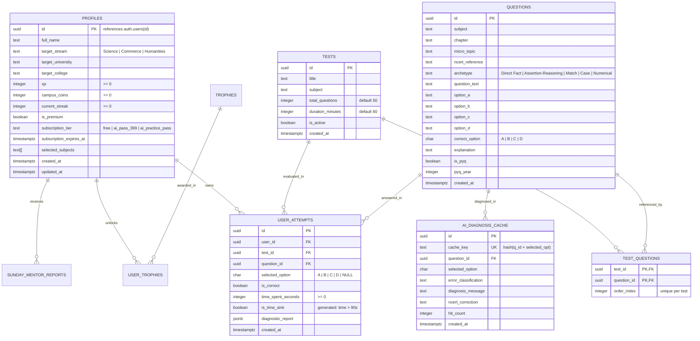

# 04 — DATA MODEL, SCHEMAS & PERSISTENCE AUDIT
## Database Architecture, Client-Side Stores & Persistence Boundaries

---

### 1. Database Entity-Relationship Diagram (PostgreSQL)

---

### 2. Client-Side Browser Storage (`localStorage`) Schema

Due to the 5MB browser storage ceiling, all client-side data is managed through `safeStorage` (`lib/storage/safe-storage.ts`).

| Storage Key | Managed By | Max Payload Size | Eviction Policy | Purpose |
|---|---|---|---|---|
| `cuet_ai_prep_session_storage:<uid>` | `useTestStore` | ~45 KB | Bounded to 15 recent attempts | Stores user stats, active streak, 150-Q cycle counts, and deduplicated test summaries. |
| `cbt_active_session:<testId>:<uid>` | `useCBTStore` | < 6 KB | Cleared upon test submission | High-frequency autosave storing visited questions, selected options, and timer deadline. |
| `cuet_active_uid` | Auth hook | ~36 B | Retained until logout | Pointer indicating the currently active authenticated or guest user ID. |
| `cuet_leaderboard_anonymous` | Profile UI | ~5 B | Retained | Privacy toggle (`"true"` / `"false"`) determining name visibility on the leaderboard. |
| `cuet_ui_lang` | Language context | ~5 B | Retained | Selected UI interface language (`"en"` / `"hi"`). |
| `cuet_push_reminder_time` | Profile UI | ~5 B | Retained | Daily revision reminder time (e.g. `"20:00"`). |

---

### 3. Source of Truth Matrix

| Entity | Primary Source of Truth | Secondary / Cache | Reconciliation Behavior |
|---|---|---|---|
| **Active Exam Answers & Timer** | `useCBTStore` memory | `localStorage` (`cbt_active_session:*`) | On reload, memory rehydrates from `localStorage`. On submit, persisted to `useTestStore` and Supabase. |
| **Historical Test Attempts** | `useTestStore` (`testAttempts`) | Supabase (`public.user_attempts`) | Merged and deduplicated via `deduplicateTestAttempts()` using composite hash (`testId + timestamp + marks`). |
| **Target College & Course** | `useTarget()` hook | `useTestStore.user` & Supabase `profiles` | Single source of truth driven by `useTarget()`; propagates to Profile, Standing, and Dashboard. |
| **Diagnostic Cycles (150-Q)** | `lib/diagnostic-status.ts` | Computed on-the-fly from qualifying Qs | Fully derived from deduplicated answered attempts; completed cycles = `floor(total / 150)`. |
| **DU Admission Cutoffs** | `lib/data/standing/normalized_cutoffs.json` | None (Read-only static 14.6MB) | Authoritative historical benchmarks; zero synthetic cutoffs. |
| **Question Bank Content** | Local JSON files in `/mock`, `/pyq`, `/practice` | Supabase `public.questions` | File system is the canonical repository build source; Supabase questions table provides DB querying. |
| **Subscription Status** | Supabase `public.profiles.is_premium` | `useTestStore.user.isPremium` | Set by Razorpay webhook using `supabaseAdmin`; checked server-side before paid actions. |

---

### 4. Persistence Risks and Safeguards

1. **`[SAFEGUARD / VERIFIED]` Storage Quota Protection (`QuotaExceededError`)**:
   - `safeStorage.setItem()` catches storage quota exceptions. If storage is full, it automatically purges disposable items (cached token logs, expired sessions) and compacts attempt payloads to <6KB before falling back to in-memory storage.
2. **`[SAFEGUARD / VERIFIED]` Cross-User Data Partitioning**:
   - All session keys are scoped with the user ID (`...:<uid>`). Logging in as a different user immediately switches the active pointer (`cuet_active_uid`), completely preventing student data cross-talk.
3. **`[RISK / LOW]` Private Browsing Storage Limitations**:
   - In Safari Private Browsing or strict incognito modes where `localStorage` is disabled or throws on write, `safeStorage` transparently uses an in-memory Map. Sessions persist throughout the tab lifecycle but do not survive tab closures.
