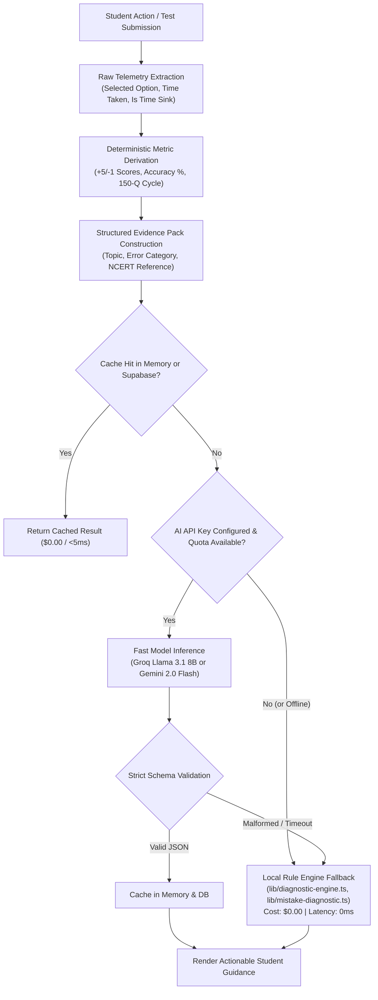

# 05 — AI SYSTEMS, ANALYTICS & TOKEN ECONOMY AUDIT
## AI Pipeline Architecture, Token Efficiency & Deterministic Fallbacks

---

### 1. Multi-Provider AI Architecture

The platform employs a **two-tier AI strategy** designed for high throughput, minimal latency, and zero required operational cost:
1. **Tier 1 (High-Throughput Diagnostic Reasoning)**: Groq LPU (`llama-3.1-8b-instant` / `groq/compound-mini`) executing in 300–800ms for option trap detection, why-wrong explanations, and doubt solving.
2. **Tier 2 (Deep Narrative & Multimodal Evaluation)**: Google Gemini (`gemini-2.0-flash` / `gemini-2.5-flash`) executing for complex college standing explanations and structured JSON diagnostic extractions.
3. **Tier 0 (Zero-Cost Deterministic Fallback Engine)**: If API keys are missing, expired, or network requests fail, the application seamlessly executes local TypeScript rule engines (`lib/diagnostic-engine.ts`, `lib/mistake-diagnostic.ts`, `lib/subject-radar-v2.ts`).

---

### 2. Comprehensive AI Feature Register

| Feature | Trigger | Input Evidence Pack | Provider & Model | Output Schema | Cache Strategy | Deterministic Fallback | Estimated Cost Evidence |
|---|---|---|---|---|---|---|---|
| **Why Wrong Explanation** | Student clicks "Why is this wrong?" in CBT review | Question text, selected option, correct option, time taken | Groq `llama-3.1-8b-instant` | `{ misconception, correctReason, trapType, ncertAdvice }` | In-memory + Supabase `ai_diagnosis_cache` | `classifyMistakeType()` rule engine in `lib/mistake-diagnostic.ts` | ~$0.00004 / call (~350 prompt tokens) |
| **Post-Mock Diagnostic** | Test completion scorecard view | Score, accuracy, time sinks (>90s), subject calibration | Groq `groq/compound-mini` | `{ summary, weaknesses: [], strengths: [], nextAction }` | In-memory key: `${userId}:${testId}` | `generateDiagnosticSummaryReport()` in `lib/diagnostic-engine.ts` | ~$0.00008 / call (~650 prompt tokens) |
| **Subject Weakness Radar** | Visiting `/dashboard/radar` (unlocked at 150 Qs) | 150-question cycle telemetry, trouble chapters, error patterns | Groq `llama-3.1-8b-instant` | `{ confidence, priorityTopics, rootCause, repairPlan }` | In-memory key: `${userId}:${subject}:${evidenceHash}` | `generateFullTopicDiagnosis()` in `lib/diagnostic-engine.ts` | ~$0.00012 / call (~950 prompt tokens) |
| **Doubt Solver Drawer** | Student enters query in Doubt Solver | Question context, student query, subject | Groq `llama-3.1-8b-instant` | Markdown explanation with KaTeX step-by-step | Memory session cache | Standard NCERT chapter formula & concept lookup | ~$0.00006 / call (~500 prompt tokens) |
| **Standing Explainer** | Clicking "Explain my chances" in Where Do I Stand | Target college, target course, student avg marks, cutoff gap | Google `gemini-2.5-flash` | `{ verdict, chancesBand, subjectMilestones, advice }` | In-memory key: `${college}:${course}:${studentAvg}` | Pure mathematical gap rule from `lib/standing-engine.ts` | ~$0.00015 / call (~800 prompt tokens) |

---

### 3. Token-Efficiency & Cost-Control Measures

1. **`[VERIFIED]` Strict 150-Question Diagnostic Gate (`lib/ai-gate.ts`)**:
   - Deep diagnostic AI analyses cannot be triggered until the student has answered at least 150 valid questions. This prevents spending AI tokens on noisy, small-sample data that cannot produce statistically sound insights.
2. **`[VERIFIED]` Token Logger & Cost Tracking (`lib/ai/token-logger.ts`)**:
   - Every API invocation records prompt tokens, completion tokens, latency, and estimated USD cost based on published model pricing.
   - Cached responses are explicitly logged with `estimatedCostUsd: 0.00`.
3. **`[VERIFIED]` Evidence Pre-Compaction**:
   - Prompts do not pass raw question arrays. Instead, `lib/diagnostic-engine.ts` pre-aggregates mistakes into concise categorical vectors (e.g., `OptionTrapCount`, `TimeSinksCount`, `AccuracyPercentage`), reducing prompt token count by over 80%.
